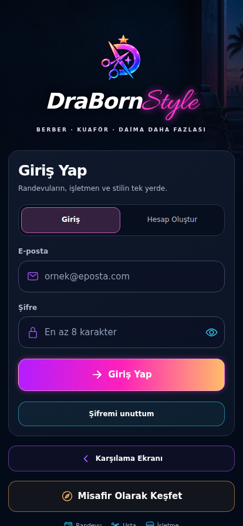
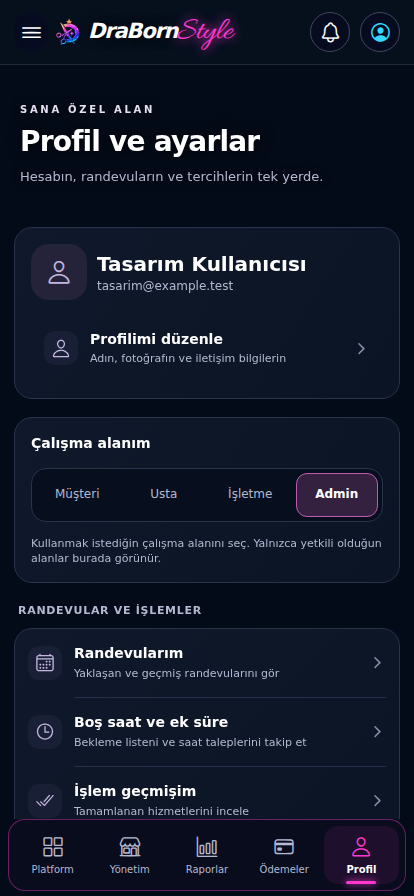

# DraBornStyle · v0.4.0

**Web sürümü:** https://www.draborneagle.com/DraBornStyle/ · Android ile aynı Expo ekranları ve Supabase verileri. [Web yayını ve senkronizasyon](docs/WEB.md).

Android için React Native / Expo ile geliştirilen berber ve kuaför randevu, günlük çalışma ve işletme yönetimi uygulaması. Müşteri, usta, işletme sahibi ve platform Admin'i ayrı çalışma ekranları kullanır. **v0.4.0 / Android version code 1** giriş logosunu aşağı taşır, Giriş / Hesap Oluştur seçeneklerini yakın ve eşit genişlikte bir seçim alanına yerleştirir, eski neon salon görselini yalnızca Login ekranında kullanır. Diğer ekranların zemini sadedir. Login logosu 120 × 120 piksel olarak marka yazısının hemen üstünde durur. Profil işlemleri açıklamalı satırlarla Randevular ve işlemler, Hesap ve izinler, İşletme gruplarına ayrılır. Finans kartındaki `<Text>` dışı boşluk kaldırılır; eski `ImageBackground` yerine mutlak konumlu `Image` kullanılır. Expo Go arka plan konum API'lerine çağrı yapmadan ön plan paylaşımını kullanır. v0.3.0 marka renkleri ve mevcut işlevler korunur. Animasyonlar hareket azaltma tercihine uyar ve uygulama arka plandayken durur.

Keşfet, yönetici/işletme/usta panelleri, aylık randevu takvimi, çalışan zaman çizelgesi ve sabit mesaj alanı yeni düzene taşınmıştır. Bütün fiyatlar, yorumlar ve saatler gerçek kayıttan gelir. [Mockup eşleştirmesi ve görsel yönergeleri](docs/DESIGN.md). v0.1.1'deki Expo Go 58.0.2 `ExpoTopicSubscriptionModule` açılış düzeltmesi korunur: [EXPO-GO-FIX.md](docs/EXPO-GO-FIX.md).





## Çalıştırma

Node.js 24 ve npm kullanın. Android cihazdaki **Expo Go 58.0.4**, Expo SDK 58 ile eşleştirilmiştir. Exact sürümler `package.json` ve `package-lock.json` içindedir. Resmî sürüm kontrolü `docs/expo-compatibility.json` dosyasındadır.

```bash
git clone https://github.com/DrabornEagle/DraBornStyle.git
cd DraBornStyle
npm ci
npx expo start
```

Telefon ve geliştirme bilgisayarı aynı ağdayken terminaldeki QR kodunu Expo Go ile açın. Bağlantı sorunu varsa cihazın bilgisayarın 8081 portuna erişebildiğini kontrol edin. API bağlantısı mevcut projeye hazırdır; varsayılan publishable key yalnızca istemci anahtarıdır, yetki sağlamaz. Başka bir istemci anahtarı kullanmanız gerekiyorsa `.env.example` dosyasını `.env` olarak kopyalayın. Supabase service-role anahtarı eklemeyin.

APK/AAB üretilmedi. `export:android` komutu yalnızca JavaScript/Hermes paketi üretir.

### Android / Termux ile ZIP üzerinden ilk kurulum

Termux ve Expo Go aynı telefonda kullanılabilir. Önce eski Metro sunucusunu terminalde **Ctrl+C** ile kapatın. Aşağıdaki komutlar Python veya patch kullanmaz; güncel kaynakları GitHub'ın ZIP arşivinden ayrı bir sürüm klasörüne indirir.

```bash
pkg update -y
pkg install nodejs-lts npm curl unzip -y
mkdir -p "$HOME/DraBornStyle-v0.4.0"
cd "$HOME/DraBornStyle-v0.4.0"
curl -fL https://github.com/DrabornEagle/DraBornStyle/archive/refs/heads/main.zip -o DraBornStyle-v0.4.0.zip
unzip -q -o DraBornStyle-v0.4.0.zip
cd DraBornStyle-main
npm ci
npm run start:termux
```

`start:termux`, SDK 58'in headless seçeneğiyle Android/Termux için bulunmayan masaüstü DevTools kurulumunu atlar; bağımlılık ve mimari kontrolleri açık kalır. Metro geliştirme modu ve uygulama hata bildirimleri çalışmaya devam eder. IPv4 önceliği, aynı telefon bağlantısını `127.0.0.1` adresinde tutar.

Termux'u açık bırakın. Expo Go **58.0.4** içinden `exp://127.0.0.1:8081` adresini açın; aynı telefon için QR okutmanız gerekmez. Terminalde sunucu hazır olmadan Expo Go'yu açmayın. Daha sonra yeniden başlatmak için:

```bash
cd "$HOME/DraBornStyle-v0.4.0/DraBornStyle-main"
npm run start:termux
```

Bu, hazırlanan cihaz deneme yoludur; fiziksel Termux/Expo Go testi bu çalışma ortamında yapılmadı. Bilgisayardan çalıştırırken yukarıdaki genel kurulum ve aynı ağdaki QR yolu kullanılabilir.

Güncel Termux paketinde npm ayrı paket olduğundan kurulum satırında açıkça yer alır: [resmî nodejs-lts paket notu](https://github.com/termux/termux-packages/blob/master/packages/nodejs-lts/build.sh). `--go`, `--localhost` ve port seçenekleri [resmî Expo CLI](https://docs.expo.dev/more/expo-cli/) davranışıdır. Eski proje klasörünüz silinmez; v0.4.0 ayrı klasörde çalışır.

## İlk deneme

1. `draborneagle@gmail.com` hesabıyla giriş yapın. Önceki sürümlerde canlı Auth API ve giriş formu doğrulandı; v0.4.0 kontrolü yerel örnek oturumla yapıldı. E-postanın çevresindeki boşluklar ve büyük harfler normalize edilir. Şifreyi göster/gizle ve Enter ile giriş kullanılabilir. Şifre hiçbir kaynak veya migration dosyasına yazılmadı. Profil → **Şifremi Güncelle** ile yeni şifre belirlenebilir.
2. İsterseniz Admin panelinde **Demo Modunu Aç** düğmesini kullanın. Demo varsayılan olarak kapalıdır; bu kayıtlar yalnızca Admin hesabının denemesinde görünür. Normal kullanıcılar ve ziyaretçiler her zaman gerçek işletmeleri görür. Üç işletme, dokuz usta, hizmetler, müşteri, randevular, sohbetler, 36 örnek tamamlanmış işlem ve kısmi ödeme bildirimi oluşur.
3. Profil → Çalışma alanım bölümünden Müşteri / Usta / İşletme / Admin ekranlarına geçin. Demo içindeki bu geçişler aynı yetkili Admin hesabının arayüz denemesidir; bağımsız kullanıcıların RLS testleri veritabanı testinde ayrıca yapılmıştır.
4. Müşteri olarak işletme, hizmet, usta ve boş saat seçin. Usta olarak **Tıraşa Başla**, misafir müşteri ve hizmet seçerek hızlı işlem deneyin.
5. İşlem sonunda hizmet tutarı, indirim, platform bedeli ve toplamı kontrol edip tamamlayın. Finans bölümünde ödeme bildirin; Admin rolünde banka/nakit kontrolünden sonra onaylayın veya reddedin.
6. **Demo Modunu Kapat**, Admin önizlemesini kapatır; tekrar gerçek veriler gösterilir. Demo kayıtları daha sonraki Admin denemesi için saklanır. Gerçek işletmeler, Auth kullanıcıları ve denetim geçmişi silinmez.

Demo veriler aktifken görünür bir DEMO bandı vardır; örnek işletmeler ve raporlar ayrıca etiketlenir. Demo işlemler seçili rapor toplamlarına dahildir. Eski sürüm ekran görüntüleri etiketli demo verilerle alınmıştır. v0.4.0 ekran görüntüleri yerel örnek hesap/API verilerinden üretilir; mevcut sunucu kayıtları değiştirilmez.

Randevu onaylandıktan sonra müşterinin konum paylaşım onayı otomatik açılır. **Daha Sonra** ile kapatılabilir. Konum izni ve paylaşımı yalnızca onay düğmesine basıldığında başlar; randevuya iki saatten fazla varsa ekran bunu açıklar ve paylaşım düğmesi kapalı kalır. Profil fotoğrafı olmayan gerçek kayıtlarda örnek usta fotoğrafı yerine kişi ikonu gösterilir.

## İşlevler

- İşletme, merkez şube altyapısı, çalışan hesabı bağlama, çalışan yetkileri, hizmet/fiyat/süre, usta-hizmet eşleştirmesi, çalışma günleri ve molalar.
- İşletme keşfi, profil, harita/adres, favoriler, yorumlar, hizmet ve usta seçimi, süreye göre müsait slotlar, randevu oluşturma/değiştirme/iptal.
- Tek dokunuşla günlük usta durumları; seçilebilir dönüş süresi; aktif sayaç, işlem uzatma, başlangıç/bitiş, kayıtlı veya misafir çat kapı müşteriler ve sıra yönetimi.
- İptalde bekleme listesi bildirimi; ekstra saat isteği, 15 dakikalık güvenli teklif bekletme ve müşteri onayı.
- Randevuyla bağlantılı metin sohbeti, hızlı cevaplar, okundu, engelleme ve bildirme; uygulama içi bildirimler ve zamanlanmış hatırlatmalar.
- Ustaya bağlı davet/indirim kodu, kişiye özel fiyat, izinli müşteri notları, temel sadakat programı, izinli müşteri duyuruları, sonraki randevuya geçiş.
- İşletme/usta/hizmet ve tarih filtreli raporlar; müşteri ve işlem sayıları, ortalama süre, net gelir, doluluk, saat dağılımı, aylık hedef ve önceki dönem karşılaştırması.
- İşletme/usta/hizmet için başlangıç tarihli platform ücret kuralı; işlemde değişmez fiyat/ücret görüntüsü; ödeme dönemleri, kısmi ödeme bildirimi, özel dekont, Admin onayı/red, borç ve değişmez denetim geçmişi.
- İşletme kapak görseli, logo, galeri, çalışan/profil fotoğrafı ve dekont yükleme arayüzleri. Yerel görsel/dekont seçicilerin gerçek Android testi beklemektedir.

## Finans kuralları

**Çat kapı dahil her tamamlanan işlem** platform hizmet bedeli oluşturur. Varsayılan 20 TL'dir. İptal ve gelmeyen müşteri ücreti doğurmaz. İşlem tekrarı ikinci komisyon veya ikinci ödeme kaydı oluşturmaz.

Para PostgreSQL'de `bigint` kuruş, indirim oranı tamsayı baz puan olarak saklanır. Randevu/işlem tutarları kaydedildikten sonra hizmet veya ücret listesi değişse bile geçmiş kayıtları değişmez. İndirim varsayılan olarak işletmenin hizmet fiyatına uygulanır; platform bedeli ayrı gösterilir. Toplamı hedefleyen kodlarda platform bedeli korunur, ilgili ek indirim hizmet tutarından karşılanır.

350 TL hizmet − %15 indirim + 20 TL platform bedeli = **317,50 TL**. 210 işlem × 20 TL = **4.200 TL**; gereksinimdeki tutarsız örnek toplamları kullanılmaz.

Müşterinin işletmeye yaptığı hizmet ödemesi ile işletmenin platforma yaptığı ödeme ayrı kayıtlardır. “Ödedim” bildirimi tek başına borcu azaltmaz. Yalnızca Admin tarafından doğrulanmış tahsilat düşülür. Hatalı işlem/iadeler silinmeden ters kayıtla tutulur. Hizmet ve platform raporları bu ters kayıtları gerçekleştiği döneme yansıtır.

Platform tahsilatı işletme düzeyindedir; usta veya hizmete bölünmüş tahsilat varmış gibi gösterilmez. Kalan borç tüm dönemleri kapsar, gelir filtresi seçilen dönem hareketlerini gösterir. Doluluk mevcut çalışma düzeniyle tamamlanmış işlemlerin kesişiminden hesaplanır; son 366 günle sınırlıdır. Tarihsel mesai değişikliklerinin tam sürümlü raporlanması sonraki sürüme bırakılmıştır. Yeni müşteri: ilk kayıtlı ziyareti seçili dönem içinde; tekrar gelen: önceki ziyareti dönem başlangıcından önce olan müşteridir.

## Supabase izolasyonu

Mevcut **DraBorn-Park-Garage-Series** projesi kullanılır (`xpdiwyxnnrmyvpcqwuyb`). Yeni proje oluşturulmadı. Tablolar `db_style` şemasında ve `db_style_` önekiyle yer alır. Diğer uygulamaların nesneleri silinmez veya resetlenmez.

`db_style` doğrudan REST şeması olarak açılmaz. `public.db_style_*` girişleri `SECURITY INVOKER` sarmalayıcıdır; mutation ve yetki kontrolleri özel şemadaki sabit `search_path` kullanan işlevlerde yapılır. SELECT için RLS, yazma için transaction/RPC kullanılır. Admin yetkisi korunmuş UUID tablosundan doğrulanır; istemci rolü, e-posta veya kullanıcı metadatası yetki sağlamaz.

Takvim randevu, aktif işlem, meşgul blok ve ekstra saat bekletmelerini tek aralık tablosunda tutar. PostgreSQL GiST exclusion constraint ve usta satır kilidi çakışmayı engeller. İşlem anahtarı/hash kontrolü ağ tekrarında aynı sonucu döndürür. İstemci bekleyen anahtarları kalıcı olarak tutar; çevrimdışıyken finans/randevu yazmaz.

- `db_style_media`: uygulama görselleri, herkese açık; yetkili önekle yüklenir.
- `db_style_receipts`: özel dekont; finans yetkisi gerekir, bağlantılar 5 dakika geçerlidir.
- `db_style_reminders`: 5 dakikada bir, randevu/vade hatırlatmaları ve süre sonlandırma.
- `db_style_push`: dakikada bir, yalnızca uygulamanın kayıtlı cihazları için gönderim/teslimat kuyruğu.

Migration dosyaları **mevcut veritabanına uygulanmıştır** ve uzaktaki sürüm kimlikleriyle eşleştirilmiştir. `.github/workflows/check.yml` tip/test/Expo paket kontrollerini çalıştırır. Gelecek migration'lar için tek projeye ve Database Read-write iznine sahip, 90 gün geçerli `SUPABASE_ACCESS_TOKEN` repository secret olarak kaydedilmiştir. `scripts/apply-migrations.mjs` yalnızca bu uygulamanın sürümlerini işler; ortak projenin diğer migration geçmişini eşitlemez.

Ortak projede `supabase db reset`, genel schema temizleme veya diğer uygulamaların eksik migration'larını değiştiren bir `db push` kullanmayın.

## Expo Go sınırları ve test bekleyenler

- Android Expo Go'da uygulama içi bildirimler kullanılır. SDK 58 bildirim paketinin ana import'u Expo Go 58.0.2'de bulunmayan `ExpoTopicSubscriptionModule` modülünü yüklediği için v0.1.1'de bu ortamda cihaz bildirim paketi hiç çalıştırılmaz. Uygulama açılışı ve bildirim düğmesi için eksik native modül regresyon testi vardır. Yerel/uzaktan cihaz bildirimleri development build testine ayrılmıştır; uzaktan push için EAS project ID ve Android FCM ayarı gerekir. Burada APK/AAB oluşturulmadı.
- Expo Go Android arka plan konum görevini çalıştırmaz. Ön plan konumu açık onayla, randevuya iki saat kala paylaşılır; bitiş/iptal/izin geri alma ile durur. Arka plan görevi development build için ayrıdır. ETA yol/trafik servisi değildir, kuş uçuşu mesafeden yaklaşık hesaplanır.
- E-posta kayıt/doğrulama/sıfırlama API ekranları vardır. Web üretim dönüş adresleri 17 Ekim 2026'da Supabase'e eklendi ve sayfa yenilenerek doğrulandı; ayrıntılar [WEB.md](docs/WEB.md) içindedir. SMTP ayarı değiştirilmedi; yeni hesap e-posta teslimatı ve Expo Go recovery deep link'i burada uçtan uca doğrulanmadı. Native üretim denemesi için uygulama dönüş URL'si (`drabornstyle://reset`, Expo Go test URL'si) mevcut redirect listesine eklenmeli, mevcut girişleri koruyun.
- Fiziksel Android cihaz, GPS/galeri/dekont seçicisi, işletim sistemi izin pencereleri ve gerçek native harita testi yapılmadı. Bunları çalışıyor olarak raporlamıyoruz.
- Çoklu şubenin veri ilişkileri hazırdır; çoklu şube yönetim ekranı, tekrar eden randevu kuralı, ziyaret sıklığına göre otomatik tekrar randevu kampanyası, rota bazlı ETA ve ses/görsel sohbet sonraki sürüm kapsamındadır.

Resmî kaynaklar: [Expo bildirim sınırları](https://docs.expo.dev/versions/latest/sdk/notifications/), [SDK 58 konum](https://docs.expo.dev/versions/v58.0.0/sdk/location/), [TaskManager](https://docs.expo.dev/versions/v58.0.0/sdk/task-manager/), [Expo sürüm manifesti](https://exp.host/--/api/v2/versions).

v0.4.0 TypeScript, 23 birim/regresyon testi ve Android/Web paket üretiminden geçti. Giriş ve profil 320, 360, 414 ve 1120 pikselde yerel örnek hesap/API verileriyle kontrol edilir; kaydedilmiş görsel sonuçlar [ui-v04-results.json](docs/ui-v04-results.json) içindedir. Web senkronizasyon iş akışı güncel kaynakta alt dizin, konum onayı, iki tarayıcı arasında Realtime ve şifre sıfırlama sayfası yenileme senaryolarını da çalıştırır. Canlı uygulama hesabına giriş, e-posta teslimatı ve fiziksel Android cihaz bu yayında doğrulanmadı. v0.3.0'ın 13 canlı okuma kontrolü ve v0.2.0'ın 17 yazma/gerçek zamanlı senaryosu tarihsel sonuçlardır. Güncel uzaktan kontroller: [GitHub Actions](https://github.com/DrabornEagle/DraBornStyle/actions).

## Kontroller

```bash
npm run typecheck
npm test
npx expo install --check
npm run export:android
npm run export:web
```

Gerçek DB testi `tests/database.sql` ile yetkili SQL bağlantısında çalışır; bütün test değişiklikleri transaction sonunda geri alınır. Mevcut Auth kimlikleri kullanılır, ortak Auth kullanıcısı oluşturulmaz/değiştirilmez. Canlı API eşzamanlılık testi için etiketli demo ve güvenli ortam değişkenleri gerekir:

```bash
node tests/live-api.mjs
```

`DB_STYLE_TEST_EMAIL`, `DB_STYLE_TEST_PASSWORD` veya dışarıdaki özel `DB_STYLE_TEST_SESSION_FILE` kullanılır. Bunları Git'e eklemeyin. Ayrıntılı sonuçlar ve gerçek cihaz deneme listesi: [docs/TEST-REPORT.md](docs/TEST-REPORT.md).

v0.3.0 kapsamlı tasarım kontrolü: `npm run export:web`, `npx playwright install chromium` ve dışarıdaki özel Admin oturum dosyasıyla `node tests/ui-design.cjs`. Mevcut demo verilerinden okur; command RPC'lerini durdurur, mesaj göndermez, demo yüklemez/kaldırmaz. Tarihsel sonuçlar `docs/ui-design-results.json` içindedir. v0.4.0 görsel/menü kontrolü için `npx playwright install chromium` ardından `npm run test:ui:v04` kullanılır. Bütün dış HTTP/WebSocket istekleri yerel örnek veriyle karşılanır veya engellenir; gerçek hesap/şifre gerekmez. Sonuçlar `docs/ui-v04-results.json` içindedir; canlı API testi olarak raporlanmaz.

Yazma içeren uçtan uca test için `node tests/ui-smoke.cjs` kullanılır. Bu test yalnız boş işletme dizini ve aktif demo bulunmayan test ortamında çalışır; kendi demo grubunu oluşturur ve sonunda temizler. Mevcut demo veya gerçek işletmelere dokunmamak için başka durumda başlamayı reddeder. Önceki sonuçlar `docs/ui-test-results.json` içindedir; bu dosya v0.4.0 tasarım testi sonucu değildir.

## Dizinler

`src/app`: oturum, rol, shell, realtime bağlantısı. `src/screens`: rol ekranları. `src/components`: ortak tasarım ve native/web harita. `src/services`: RPC, dosya, konum, bildirim. `src/hooks`: veri yükleme. `src/lib`: güvenli Supabase istemcisi. `src/theme`, `src/types`, `src/utils`: tasarım, veri sözleşmeleri, kuruş/tarih işlemleri. `assets/art`: özgün ve optimize edilmiş görseller. `supabase/migrations`: sürümlü veritabanı değişiklikleri. `docs`, `tests`, `scripts`: doğrulama ve bakım.
